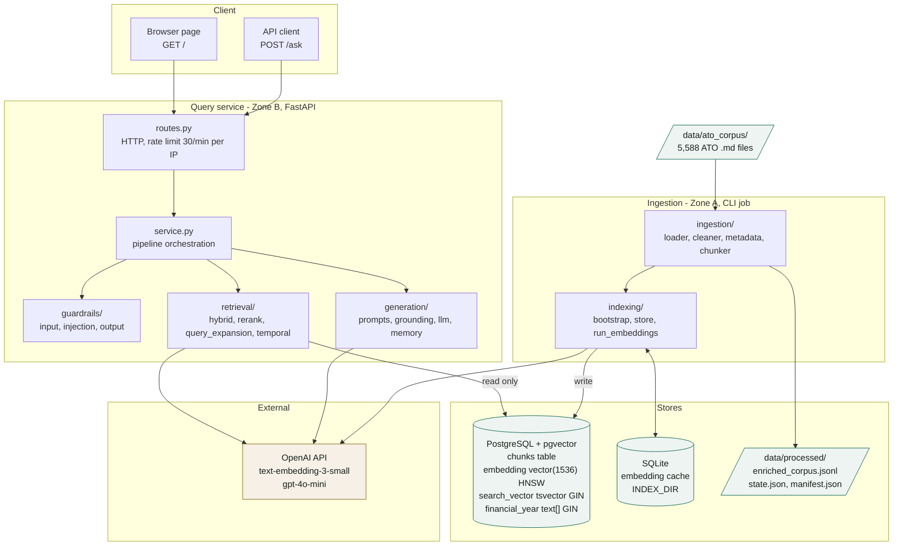
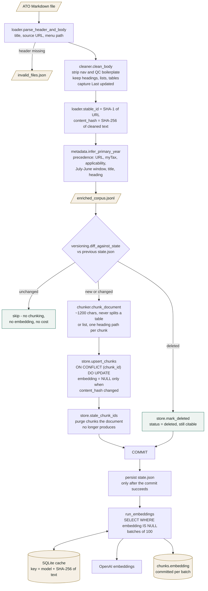
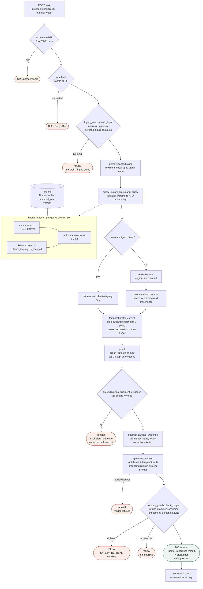

# Architecture

Three views of the same system:

1. [System architecture](#1-system-architecture) - the components, what they own, and
   what talks to what.
2. [Data flow A: ingestion](#2-data-flow-a--ingestion-zone-a-offline) - how an ATO
   Markdown page becomes a retrievable, cited chunk.
3. [Data flow B: answering a question](#3-data-flow-b--answering-a-question-zone-b-request-time) -
   how a question becomes a grounded answer, or an honest refusal.

The two halves run at different times and never run in the same process. Zone A is
offline and writes the index; Zone B serves requests and only reads it.

---

## 1. System architecture

**Deployment.** Both halves ship as one image (`docker/api.Dockerfile`); the entry point
decides which half runs. Locally, `docker compose` runs the API and Postgres. On
Kubernetes (`deploy/k8s/`) the API is a 2-replica Deployment behind a ClusterIP Service,
and Postgres is a single-replica StatefulSet with a 10 Gi volume. Configuration comes
from a ConfigMap, credentials from a Secret.

Two consequences of running two replicas, both deliberate and both documented in
`api-deployment.yaml`: the rate limiter counts in process memory, so N replicas allow N
times the limit, and conversation memory is per process, so a follow-up that lands on
the other pod has no history. **Ingestion is not yet a cluster workload** - it is run
manually against the same database.

---

## 2. Data flow A - ingestion (Zone A, offline)

Run with `python scripts/ingest.py`. Nothing here is on the request path.

**Why the checkpoint sits after the commit** (ADR-0004). If `state.json` advanced first
and indexing then failed, the next run would compare against the new state, conclude
nothing had changed, and index nothing - a silent empty index. Writing it only after a
successful commit means a failed run simply repeats.

**What makes a re-run cheap.** The content hash covers *cleaned* text, so a re-scrape
that only changes the scrape timestamp is not a change. An unchanged chunk keeps its
vector, because the upsert clears `embedding` only when that chunk's own hash moved.
Editing one paragraph of a long page therefore re-embeds one chunk, not the page.

---

## 3. Data flow B - answering a question (Zone B, request time)

`POST /ask`, orchestrated by `api/service.py`. Every red path is a refusal, and a
refusal returns HTTP 200 with `diagnostics.refused` - it is a correct outcome, not an
error.

### The refusal branch is the point

Five independent paths end in a refusal, and only one of them involves the model. The
cheap checks run first: a guard costs a regex, and the grounding gate costs nothing
beyond retrieval that already happened. Only a question that survives both is worth
paying a model call for.

A confident wrong answer about someone's tax is far more damaging than "I don't have
enough information to answer that."

Two refusals that look alike are deliberately kept distinct, because they mean different
things: **insufficient evidence** says the corpus did not cover it, while
**SAFETY_REFUSAL** says the answer existed but would have read as personal advice.
Reporting both as "not enough information" once sent a reader hunting for a retrieval
problem that was not there.

### Year-scoped questions read superseded content

When a request names a `financial_year`, the filter switches `active` off, so
superseded guidance becomes visible. A question about 2021-22 should be answered from
the guidance that applied then, which is exactly what `Status.SUPERSEDED` exists to
preserve. Undated questions get the opposite treatment from `prefer_current`.

Note that a year filter still matches evergreen chunks - roughly three quarters of the
corpus carries no year at all, and that is where most answers live (ADR-0002).

---

## Tuning knobs

All are environment variables, read through `config.Settings`:

| Setting | Default | Effect |
|---|---|---|
| `SHORTLIST` | 30 | Candidates retrieved per query before reranking |
| `EVIDENCE_COUNT` | 15 | Passages handed to the model |
| `CITATION_LIMIT` | 5 | Sources shown to the user |
| `FAMILY_CAP` | 2 | Limits near-identical pages in one shortlist |
| `RERANK_STRATEGY` | `fusion` | `fusion`, `mmr` or `llm` (ADR-0003) |
| `RATE_LIMIT_PER_MINUTE` | 30 | Per replica, not per service |

`scripts/probe/sweep_k.py` and `sweep_rerank.py` measure the first and fifth of these
against known-answer questions, so the values can be chosen on evidence.

## Where the decisions are recorded

- **ADR-0002** - one Postgres table serves both retrieval halves; financial year is an
  array, not a scalar.
- **ADR-0003** - three rerankers compared; `fusion` ships because neither alternative
  beat it measurably.
- **ADR-0004** - incremental indexing and the state checkpoint.
